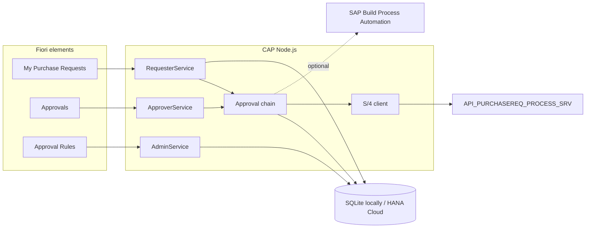
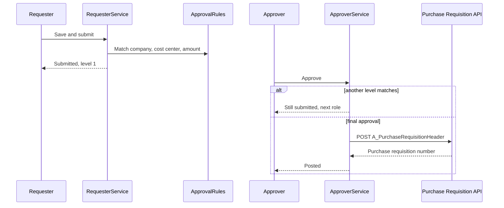

# Purchase request approval

A starter SAP BTP application for creating, approving, and posting purchase requests. It is a [CAP Node.js](https://cap.cloud.sap/) service with three SAP Fiori elements apps, mock data for `cds watch`, and an MTA for Cloud Foundry.

The approval chain lives in the app so you can run the whole flow offline. A marked hook in `srv/lib/bpa.js` is where SAP Build Process Automation can take over. Final approval calls S/4HANA `API_PURCHASEREQ_PROCESS_SRV`. Locally that API is mocked. In production it is the destination `S4HANA`.





## Repository

```
db/schema.cds                         domain model
db/data/                              sample CSV loaded on each start
srv/requester-service.cds             draft-enabled requests, submit, withdraw
srv/approver-service.cds              inbox, approve, rejectRequest
srv/admin-service.cds                 approval rules
srv/external/API_PURCHASEREQ_PROCESS_SRV.cds
srv/lib/approval-chain.js             rule matching
srv/lib/bpa.js                        Build Process Automation hook
srv/lib/s4-client.js                  map and post the requisition
app/my-purchase-requests/             requester list report and object page
app/approvals/                        approver inbox
app/approval-rules/                   admin rules
.deploy/app-router/                   standalone approuter
mta.yaml                              HANA, XSUAA, destination, connectivity, HTML5 repo
xs-security.json                      roles and role collections
test/purchase-request.test.js
```

## Run locally

Requires Node.js 22 or newer.

```bash
npm install
npm run watch
```

`cds watch` is `cds serve --with-mocks`. The database is SQLite in memory, filled from `db/data` on every start. Nothing you create survives a restart. To keep a file instead, set `cds.requires.db.credentials.url` in `package.json` to `db.sqlite`.

Open [http://localhost:4004](http://localhost:4004). The home page lists the services and the three apps:

| App | URL |
| --- | --- |
| My Purchase Requests | http://localhost:4004/my-purchase-requests/webapp/index.html |
| Approvals | http://localhost:4004/approvals/webapp/index.html |
| Approval Rules | http://localhost:4004/approval-rules/webapp/index.html |

The browser loads SAPUI5 from `https://sapui5.hana.ondemand.com`. The first OData call asks for basic authentication.

| User | Password | Role | What they can do |
| --- | --- | --- | --- |
| alice | alice | Requester | Her own requests. Sample data belongs to her. |
| erin | erin | Requester | Same role, empty list. Use her to see the per-user filter. |
| bob | bob | Approver | Level 1. Sample `PR10000002` is waiting for him. |
| dave | dave | FinanceApprover | Level 2, above 5,000. Sample `PR10000004` is waiting for him. |
| carol | carol | Admin | Approval rules. |

Try this:

1. Sign in as **alice**. Open the draft `PR10000001`, or create a request with a company code, cost center, plant, currency, and at least one item. Save, then **Submit**.
2. Sign in as **bob**. Amounts up to 5,000 post to S/4 on his approval. Above that, his approval moves the request to **dave**. The reject button calls the action `rejectRequest`. CAP already uses `reject` as the error helper, so the OData name cannot be `reject`.
3. Sign in as **carol** to change the bands.

A submitted request with no decisions yet can be withdrawn. A rejection needs a comment. The requester can edit a rejected request and submit it again. Earlier decisions stay on the approval history.

`npm test` runs the same flow against an in-memory server and the mocked S/4 service. While `cds watch` is running, the mock is also browsable at `/odata/v4/api-purchasereq-process-srv/A_PurchaseRequisitionHeader`. That endpoint is not part of the production service.

## Approval rules

`ApprovalRules` match on company code, an optional cost center, and an amount band. A blank cost center matches every cost center. A blank maximum has no upper bound. At one level, a cost-center-specific rule replaces the generic rules. Two rules that still tie at the same level are rejected at submit time so the chain stays unambiguous.

Sample bands for company `1000`:

| Amount | Levels |
| --- | --- |
| 0 to 5,000 | Approver |
| 5,000.01 to 100,000 | Approver, then FinanceApprover |

`approverRole` is the XSUAA role name (`Approver`, `FinanceApprover`). Add a role in `xs-security.json` and in the mocked users when you add a band.

`totalAmount` is stored and recomputed from `quantity * unitPrice`. The service checks, on save, that the cost center is present and that every item has a positive quantity, a positive unit price, a unit, a material group, and a delivery date. Submit also requires a description, company code, plant, currency, and a total above zero.

## S/4HANA

The client in `srv/lib/s4-client.js` posts a standard requisition (`NB`) with account assignment category `K` and the request's cost center. The G/L account `400000` and purchasing group `001` are constants. Replace them with a determination before you point this at a real system. The header text sent to S/4 is the first 40 characters of the description.

`srv/external/API_PURCHASEREQ_PROCESS_SRV.cds` is the slice of the API this app calls (header, item, account assignment). The Business Accelerator Hub metadata is behind an API key, so it is not imported. When you have the EDMX:

```bash
cds import API_PURCHASEREQ_PROCESS_SRV.edmx --as cds --into srv/external
```

Keep the service name `API_PURCHASEREQ_PROCESS_SRV`. The production profile in `package.json` sends it to the destination `S4HANA` at `/sap/opu/odata/sap/API_PURCHASEREQ_PROCESS_SRV`.

### Destination and Cloud Connector

Create the destination in the subaccount after deploy. `config/s4hana-destination.example.json` is the shape:

| Property | Value |
| --- | --- |
| Name | `S4HANA` |
| Type | HTTP |
| ProxyType | OnPremise |
| Authentication | PrincipalPropagation |
| URL | `http://<virtual-host>:<port>` from Cloud Connector |
| sap-client | your client, often `100` |

Cloud Connector, not the MTA, reaches the S/4 host:

1. Connect the subaccount in Cloud Connector and trust the BTP subaccount.
2. Add a Cloud to On-Premise mapping. The virtual host is what the destination URL uses. The internal host is the S/4 application server.
3. Expose `/sap/opu/odata/sap/API_PURCHASEREQ_PROCESS_SRV` and the path access policy you use for principal propagation.
4. Enable principal propagation (X.509) and map the BTP user to the S/4 user. Short-lived certificates come from the connectivity and XSUAA setup in the subaccount.
5. The `srv` module is bound to the Destination service and the Connectivity service (`lite`). CAP uses both when `cds.requires.destinations` is true, which the production profile turns on.

Do not put S/4 credentials in git. Principal propagation means the approver who posts the requisition is the S/4 user.

If posting fails, the approval transaction rolls back and the request stays submitted. The approver can retry. Splitting "approved" from a retryable "post" is a reasonable next step when S/4 is unreachable often.

## SAP Build Process Automation

`startApprovalFlow` in `srv/lib/bpa.js` is the swap-in point. With `BPA_ENABLED` unset, submit writes `currentLevel` and `pendingApproverRole`, and approvers act in ApproverService.

To move that to a process:

1. Model the chain as a process. Each step's recipient is the rule's `approverRole`.
2. Create a destination `BUILD_PROCESS_AUTOMATION` with OAuth2 client credentials for the workflow runtime.
3. Set `BPA_ENABLED=true` and `BPA_DEFINITION_ID` on `purchase-request-srv`.
4. Replace the stub in `startBuildProcessAutomation`. The comment there has the `POST /workflow/rest/v1/workflow-instances` shape.
5. Have the process call `approve` and `rejectRequest` with a technical user that holds the matching role, or add a callback action.
6. Return `true` from the stub only after the process instance exists. Returning `false` keeps the in-app flow, so a half-wired hook never drops a request.

## Deploy to SAP BTP, Cloud Foundry

Entitlements: HANA Cloud `hdi-shared` (on a trial landscape this is sometimes `hana` / `hdi-shared` under a free plan; change the resource in `mta.yaml` if your entitlement name differs), XSUAA `application`, Destination `lite`, Connectivity `lite`, HTML5 Application Repository `app-host` and `app-runtime`.

Install the [Cloud MTA Build Tool](https://github.com/SAP/cloud-mta-build-tool) and the [MultiApps CF CLI plugin](https://github.com/cloudfoundry/multiapps-cli-plugin).

```bash
cf login -a https://api.cf.<region>.hana.ondemand.com
cf target -o <org> -s <space>

npm install
mbt build
cf deploy mta_archives/purchase-request_1.0.0.mtar
```

`mbt build` runs `npm ci --include=dev`, `cds build --production`, and `scripts/pack-html5.mjs`. Production uses the HANA service, XSUAA, and the S/4 destination. The Node buildpack also sets `NODE_ENV=production`; `mta.yaml` sets it explicitly.

The approuter module is the user-facing app (`purchase-request`). To run that router locally against `cds watch`, copy `.deploy/app-router/approuter-env.example.json` to `default-env.json` in the same folder (`default-env.json` is gitignored) and start `@sap/approuter` there. The example points `srv-api` at `http://localhost:4004`. HTML5 apps are deployed to the HTML5 repository. After deploy, open:

- `https://<approuter>/pr.myrequests/index.html`
- `https://<approuter>/pr.approvals/index.html`
- `https://<approuter>/pr.approvalrules/index.html`

If the path differs, the HTML5 Applications list in the cockpit shows the `sap.app.id`. The approuter route sends `/odata/*` to the CAP service with the user token.

Assign the role collections created from `xs-security.json`:

| Collection | Template |
| --- | --- |
| PR_Requester | Requester |
| PR_Approver | Approver |
| PR_FinanceApprover | FinanceApprover |
| PR_Admin | Admin |

In the cockpit: Security, Users, assign the collection. With the btp CLI, `btp assign security/role-collection PR_Requester --to-user <email>` (plus the identity provider flag your subaccount requires).

Create the `S4HANA` destination as above before the first real posting. The MTA creates the destination service and a `ui5` destination for the CDN. It does not create `S4HANA`, so a placeholder cannot mask a missing virtual host.

Supplier quotes use `@cap-js/attachments` and are stored in the database (SQLite locally, HANA Cloud in production). `cds.fiori.move_media_data_in_db` is on so draft binaries stay in the table. To move them to SAP Object Store, bind the store and follow the plugin's `attachments.kind` settings, and turn that Fiori flag back off so the plugin streams content out of the draft on save.

## Tests

```bash
npm test
```

Jest and `cds.test` cover owner isolation, the approver inbox, save validation, a one-level post, a two-level post, rejection, withdraw, the Fiori draft activate path, and admin rules. S/4 is the in-process mock. The posted requisition is read back from `A_PurchaseRequisitionHeader`, the item, and the cost-center account assignment.

## Next steps

- Import the full purchase requisition EDMX and replace the constants in `srv/lib/s4-client.js` with G/L and purchasing-data determination.
- Add a number range or purchasing group per company code if you already model that in Datasphere or S/4 customizing.
- Subscribe the approver task to SAP Build Process Automation, then drop the in-app level advance.
- Replicate `PurchaseRequests`, `Items`, and `Approvals` into SAP Datasphere (replication flow or the CAP service as an Open SQL / OData source) if you want cycle time and rejection reasons next to finance actuals.
- Notify the requester on reject and post. Event Mesh or a mail destination fits beside the BPA hook.
- Add Object Store when quote volume outgrows the HANA column store, and turn on the plugin's malware scan.
- Put the three apps on a SAP Build Work Zone site. The manifests already carry inbound intents (`PurchaseRequest-manage`, `PurchaseRequest-approve`, `ApprovalRule-maintain`).
